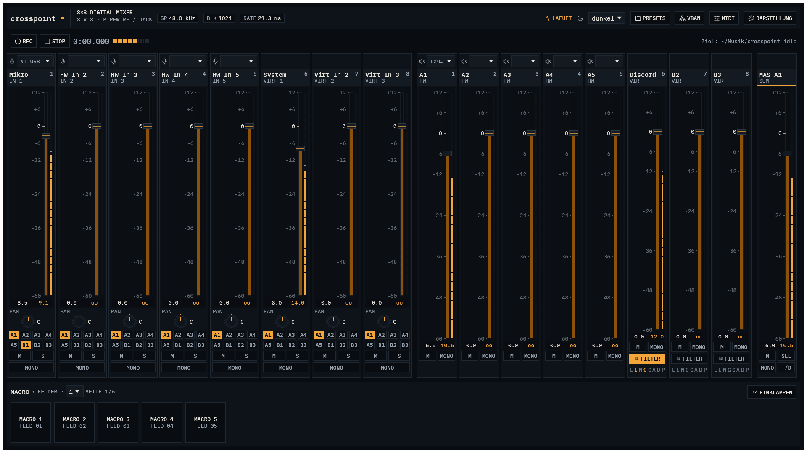
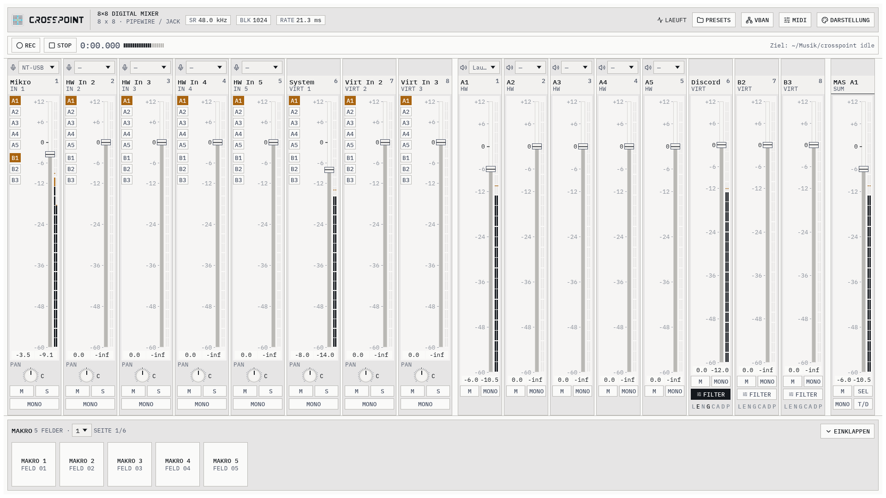
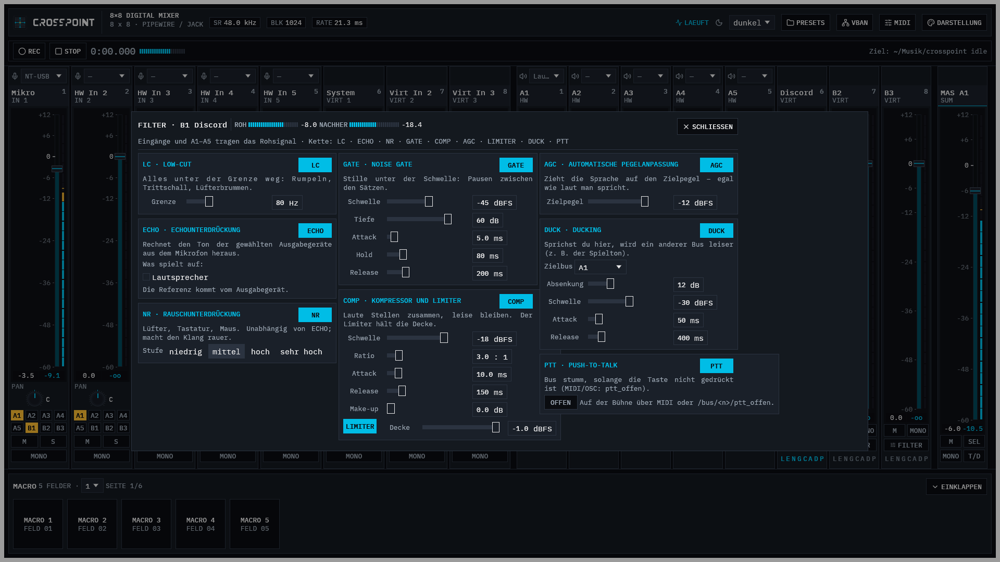

# Crosspoint

<p align="center">
  
</p>

Crosspoint ist ein 8×8-Audiomischer für Linux. Es richtet sich an Leute, die ein
Mischpult-Modell gewohnt sind – so etwas wie VoiceMeeter unter Windows –, aber
auf Linux arbeiten und nicht ständig zwischen Systemeinstellungen und den
Geräteauswahlen einzelner Programme hin und her wechseln wollen. Man legt einmal fest,
woher der Ton kommt und wohin er geht, und dreht danach an Fadern statt an
Geräteauswahllisten.

Der typische Fall: ein Mikrofon, Musik aus dem Browser, Discord und OBS laufen
gleichzeitig. Statt dass alles auf einem Ausgang landet, bekommt jedes Programm
seinen eigenen Eingang. Das Mikrofon geht unverändert auf Kopfhörer und
Aufnahme, und nur die Stimme, die nach Discord oder OBS geht, wird aufgeräumt:
Low-Cut, Echounterdrückung und Gate sitzen dort, wo sie gebraucht werden.

Crosspoint arbeitet ohne Kernelmodul. Es ist ein JACK-Client und braucht
PipeWire; die virtuellen Geräte, die die anderen Programme sehen, legt es beim
Start selbst an.

## Grundbegriffe

**Eingänge.** Acht Kanalzüge. Fünf davon sind Hardware-Eingänge (HW In 1–5), an
denen das Mikrofon, das Interface oder das Mischpult hängt. Drei sind virtuell
(Virt In 1–3): das sind die Geräte `CROSSPOINT-Input-1` bis `CROSSPOINT-Input-3`,
in die Programme ihren Ton spielen – Browser, Spiel, Musikplayer.

**Busse.** Acht Summen, auf die die Kanäle gelegt werden. A1–A5 gehen auf echte
Ausgänge, also Kopfhörer, Boxen, Interface. B1–B3 sind virtuell: sie erscheinen
als `CROSSPOINT-Output-B1` bis `CROSSPOINT-Output-B3` und sind das, was andere
Programme als Mikrofon auswählen – Discord, OBS, Zoom.

**Zuordnung.** In jedem Kanal stehen acht Tasten, `A1` bis `B3`. Sie bestimmen, auf welche Busse dieser Kanal geht. Ein Mikrofon auf A1
*und* B1 ist der Normalfall: auf A1 hört man es selbst, auf B1 geht es in die
bearbeitete Fassung.

**Filter.** Sie sitzen an den virtuellen Bussen B1–B3, also dort, wo das Signal
zu anderen Programmen oder in eine Aufnahme geht. Eingänge und A1–A5 tragen das
Rohsignal. Zur Verfügung stehen Low-Cut, Echounterdrückung (rechnet den Ton
heraus, den die Boxen spielen und das Mikrofon wieder aufnimmt),
Rauschunterdrückung, Noise Gate, Kompressor mit Limiter, AGC, Ducking und
Push-to-Talk. Der Knopf **FILTER** am Bus öffnet sie; acht Lämpchen zeigen, was
gerade an ist.

Fader, Pan, Mono und Stummschaltung gibt es wie an einem Pult, inklusive einer
Master-Reihe, die einen der acht Busse bedient.

## Installation

Nur Linux. Fertige Pakete liegen unter [Releases](https://github.com/patimweb-labs/crosspoint/releases):

| Weg | Datei | Befehl |
| --- | --- | --- |
| Flatpak (jede Distribution) | `crosspoint-*.flatpak` | `flatpak install --user ./crosspoint-*.flatpak` |
| AppImage (jede Distribution) | `Crosspoint-*-x86_64.AppImage` | `chmod +x Crosspoint-*.AppImage && ./Crosspoint-*.AppImage` |
| Archiv | `crosspoint-*-linux-x86_64.tar.gz` | nach `~/.local` oder `/usr/local` entpacken |

Voraussetzung: PipeWire mit `pipewire-jack` und `pactl` (bei Fedora, Ubuntu,
Debian, Arch und openSUSE Standard). Das Flatpak bringt beides selbst mit.

## Erste Schritte

Ein üblicher Ablauf, vom leeren Pult bis zum fertigen Gespräch:

1. **Starten.** Über das Menü, per AppImage oder mit
   `flatpak run de.weppelmann.Crosspoint`. Crosspoint legt dabei die virtuellen
   Geräte an; beim Schließen räumt es sie wieder weg.
2. **Ausgang wählen.** Am Zug A1 steht oben ein Auswahlfeld mit allen
   Ausgabegeräten. Dort Kopfhörer oder Boxen eintragen. Ohne Auswahl bleibt A1
   unverbunden – Crosspoint rät nicht.
3. **Mikrofon wählen.** Dasselbe Feld am Zug HW In 1, hier mit den
   Aufnahmegeräten. Die Wahl wird gemerkt und beim nächsten Start
   wiederhergestellt.
4. **Programm einspeisen.** Im Browser (oder im Spiel, im Player) als
   Ausgabegerät `CROSSPOINT-Input-1` einstellen. Der Ton kommt dann auf Kanal 6
   an, dem Zug Virt In 1.
5. **Programm versorgen.** In Discord oder OBS als Mikrofon
   `CROSSPOINT-Output-B1` auswählen. Was auf Bus B1 liegt, ist dort das
   Mikrofon.
6. **Zuordnen und mischen.** Im Mikrofonkanal `A1` und `B1` drücken, im
   Browserkanal `A1`. Jeder Kanal liegt ab Werk auf A1; alles Weitere ist eine
   Frage der Fader. Wer die Stimme in Discord aufräumen will, öffnet am Bus B1
   das **FILTER**-Modal und schaltet Low-Cut, Echounterdrückung und Gate ein.

## Weitere Funktionen

**Presets.** Der Dialog PRESETS sichert das ganze Pult unter einem Namen und
lädt es wieder. Zusätzlich merkt sich Crosspoint den letzten Zustand selbst und
stellt ihn beim Start wieder her.

**Aufnahme.** Der Knopf REC in der Kopfzeile schreibt Bus A1 als WAV-Datei in
den Tape-Ordner; die Uhr daneben läuft mit.

**VBAN.** Schickt Bus A1 als Netzwerk-Audio an einen anderen Rechner und nimmt
einen VBAN-Strom entgegen, wenn man den Ton über Ethernet verteilen will.

**MIDI.** Über [MIDIMonster](https://github.com/cbdevnet/midimonster) lassen
sich Fader und Tasten eines Controllers anschließen; eine fertige Zuordnung für
das nanoKONTROL2 liegt in `data/midimonster.cfg`.

**OSC.** Die Engine hört auf UDP-Port 9000 und nimmt dort `/strip/0/gain` und
Verwandte entgegen. Das ist der Weg, über den MIDI hereinkommt.

**Web-Fernbedienung.** Unter `http://127.0.0.1:8770` liegt eine Fernbedienung
im Browser – praktisch, wenn der Rechner am Pult steht und man vom Sofa aus
nachregeln will.

**Makros.** Eine Leiste mit Tasten, die mehrere Einstellungen auf einmal setzen
oder umschalten, in Seiten sortiert. Wie viele Tasten sie zeigt – oder ob sie
ganz verschwindet –, stellt man im Dialog DARSTELLUNG ein.

**Autostart und Tray.** Im Dialog DARSTELLUNG trägt sich Crosspoint auf Wunsch
in den Autostart ein; es startet dann nur als Symbol im Tray, ohne Fenster.

**Themes.** Drei Darstellungen – dunkel, hell, mono –, umschaltbar im Dialog
DARSTELLUNG.

## Screenshots







## Kommandozeile

```
crosspoint                 Fenster und Engine in einem Prozess
crosspoint --minimized     nur Tray-Symbol, kein Fenster
crosspoint --version       Version ausgeben und beenden
crosspoint-engine          nur die Engine, ohne Fenster
```

Ein zweiter Start neben einer laufenden Instanz startet keine zweite Engine,
sondern holt das Fenster der ersten nach vorn.

`./scripts/crosspoint-wire.sh up|down|status|sweep` legt die virtuellen Geräte
von Hand an, entfernt sie oder zeigt die Verbindungen. Die Engine ruft das beim
Start und beim Beenden selbst auf; `CROSSPOINT_NO_WIRE=1` schaltet das ab.
`CROSSPOINT_A1` bis `CROSSPOINT_A5` geben einem Hardware-Bus ohne Fenster ein
Ziel. `CROSSPOINT_NO_RESTORE=1` verhindert, dass der gemerkte Zustand geladen
und weiter gesichert wird.

## Daten und Datenschutz

Crosspoint arbeitet ausschließlich lokal. Die Steuer-API hört auf
`127.0.0.1:8770`, VBAN nur auf dem eingestellten UDP-Port. Keine Telemetrie,
keine Konten, keine Cloud-Verbindung. Konfiguration und Presets liegen unter
`~/.config/crosspoint`, Aufnahmen im eingestellten Tape-Ordner.

## Selbst bauen

```bash
cargo build --release --features ui
./scripts/crosspoint-launch.sh
```

Gebraucht werden `cargo`, `clang` (für bindgen) sowie PipeWire mit
`pipewire-jack` und `pactl`; die `-devel`-Pakete dafür sind nicht nötig. Wie das
Projekt aufgebaut ist und warum welche Entscheidung so gefallen ist, steht in
`docs/` – `docs/architektur.md` für die Schichten, `docs/datenfluss.md` für den
Weg eines Befehls bis zum Bild, `docs/adr/` für die Entscheidungen. Wer
mitschreiben will, liest vorher `AGENTS.md`; dort stehen die Regeln, an die sich
Code und Tests hier halten.

## Lizenz

GPL-3.0, siehe [LICENSE](LICENSE).

Fehler und Wünsche:
https://github.com/patimweb-labs/crosspoint/issues
