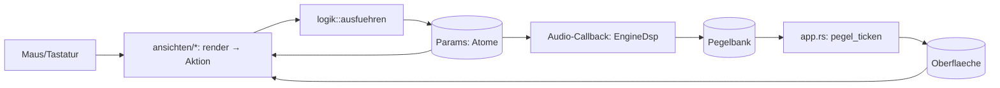

# Datenfluss

Was ein Bedienschritt auslöst, bis das Bild steht. Ein Prozess: Fenster (egui)
und Engine laufen im selben Binary (`crosspoint` mit Feature `ui`).

## „Fader ziehen"

1. **Ansicht** (`crates/fenster/src/bausteine.rs`, `fader`): der Zug liefert einen
   neuen Wert; `logik::fader_ziehen` rechnet Pixel in dB um und hält die
   0-dB-Raste (`fmt::einrasten`).
2. **Aktion** `Setzen { ziel, param: "gain", wert }` geht an
   `logik::ausfuehren`, das `Params::set` aufruft – das Atom
   `StripParam::gain` (`crates/core/src/engine.rs`), kein Puffer, kein JSON.
3. **Audio-Thread** (`EngineDsp::process`): liest das Atom im nächsten Block,
   Fader und Pan, dann die Routing-Matrix über `StripParam::sends`.
4. **Pegel** (`crates/core/src/pegel.rs`): der Callback schreibt Spitzenwerte je
   Eingang und Bus.
5. **Anzeige** (`app.rs`, 33-ms-Takt): `logik::pegel_ticken` glättet und hält
   die Spitze im Modell (`Oberflaeche::pegel`), die Ansicht zeichnet daraus.

## „ECHO an B1"

1. Linksklick auf ECHO am Zug B1 → `Setzen { ziel: Bus(5), param: "aec" }`.
2. `Params::set` → `AusgangsFilter::set` (nur virtuelle Busse haben einen
   `AusgangsFilter`; an A1–A5 wird `aec` abgelehnt und gemeldet).
3. Audio-Thread: `reconfigure` sieht den Wechsel auf „an" und leert die Puffer
   der Echounterdrücker; im Sample-Takt nimmt `process` das Sample von
   `crosspoint:echo_ref_L/R` als Referenz (die Monitore der gewählten
   Ausgabegeräte, siehe Abschnitt „Echo-Referenz“) und rechnet B1 damit
   (`crates/core/src/aec.rs`, AEC3 aus `sonora`), danach folgt das Gate. Die
   Ausgabe kommt 19 ms später (10 ms Rahmen + 9 ms AEC3); ist die Referenz
   still, geht das Mikrofon unverändert und nur verzögert durch.

## „Echo-Referenz wählen"

1. Rechtsklick auf ECHO → `Aktion::Aufklappen(Some(Aufklapp::Echo(bus)))`; das
   Menü hängt am Knopf und zeigt die Ausgabegeräte aus `geraete::Bestand::senken`
   (plus die gemerkten, die gerade fehlen) mit einem Häkchen je Gerät.
2. Klick auf ein Häkchen → `Aktion::EchoGeraet { name, an }` →
   `logik::ausfuehren` bildet die neue **Liste** (die anderen Geräte bleiben) und
   ruft `echo::setzen` über den `Zuordner` (`crates/fenster/src/geraete.rs`).
3. `echo::setzen` löst alle Links an `crosspoint:echo_ref_L/R` und legt für jedes
   gewählte Gerät `<sink>:monitor_FL/FR` darauf (dieselben pw-Wege wie
   `devices.rs`/`inputs.rs`), dann schreibt es `echo.json`.
4. Beim Start macht das `echo::beim_start`; kommt ein Gerät zurück, legt es der
   Wächter (`wache::abgleich`) nach. Der Audio-Thread liest die Ports und rechnet
   sie als Referenz – kein Neustart, kein Modul.
   `GET/POST /api/echo` ist derselbe Weg von außen.

## „Master bedienen"

1. SEL am Master → Auswahl → `Aktion::MasterBus(i)` (Fenstereinstellung,
   `fenster.json`).
2. Master-Fader, Mute, Mono, GATE/ECHO (wenn der Bus virtuell ist) schreiben
   **auf den gewählten Bus** – der Master ist eine Fernbedienung, keine zweite
   Summe.

## „Aufnahme (Tape)"

1. REC → `Aktion::TapeStart` → `TapeControl::recording` (`crates/core/src/tape_io.rs`);
   die Uhr steht im Modell (`Tape::Aufnahme { seit }`).
2. Der Audio-Callback schreibt den Ring, der Tape-Schreiber die WAV-Datei.

## „Fenster zu" mit Tray

1. Der Fensterknopf schließt das Fenster (`run_native` kehrt zurück).
2. `betrieb::danach` wartet auf „Fenster zeigen" (Tray), `POST /api/fenster`
   (zweiter Start) oder „Beenden"/Engine-Ende; dann neues Fenster oder Ende.

## Web-Oberfläche

`crates/core/src/http.rs` liefert unter `127.0.0.1:8770` dieselben Parameter als
JSON (`/api/state`, `/api/set`, `/api/levels`) und `web/index.html`. Sie ist
**keine** zweite Wahrheit: beide Wege schreiben in dieselben Atome.
